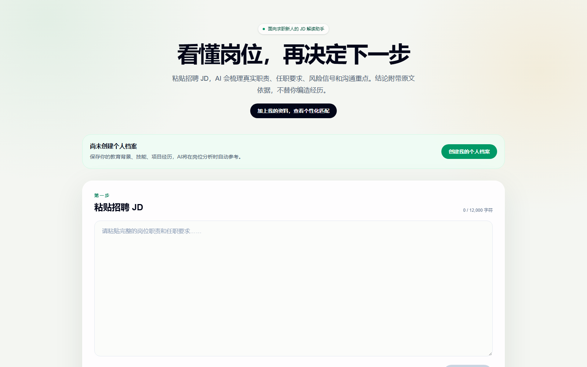
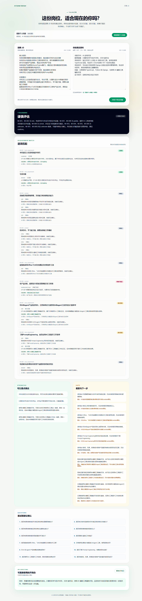
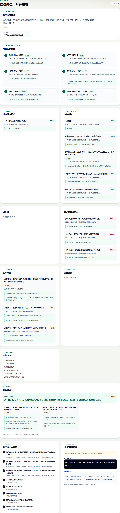
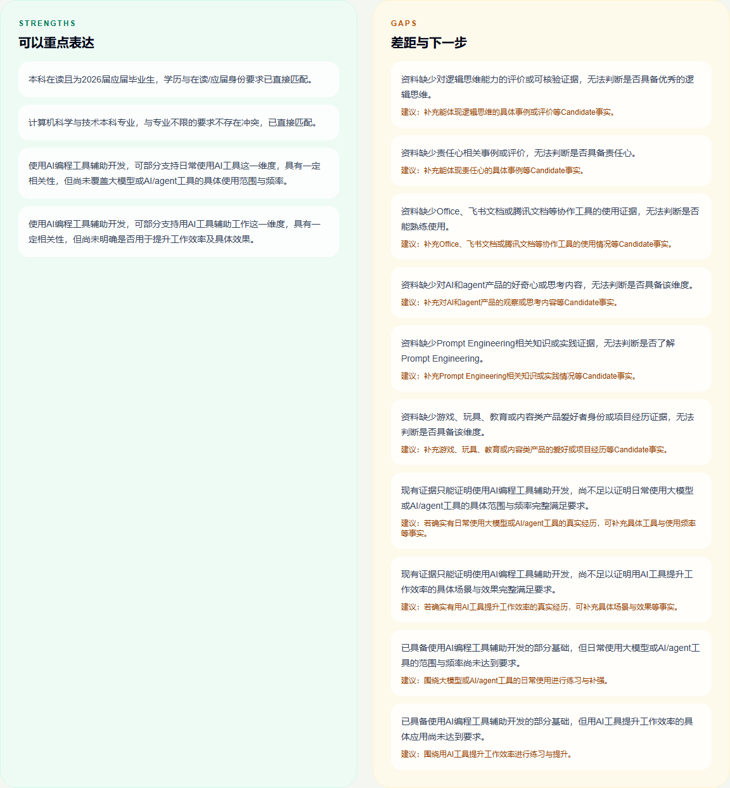
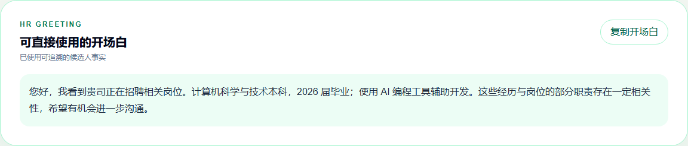
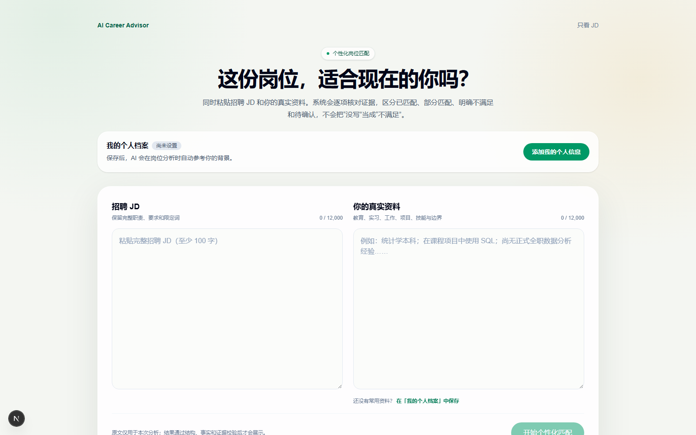
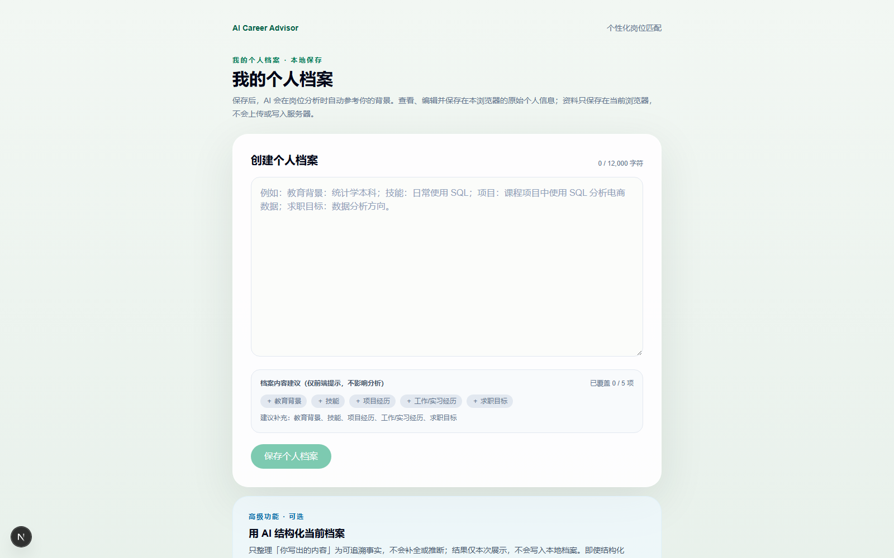

# AI Career Advisor

> 把一段招聘 JD 变成一份**每条结论都能回溯到 JD 原文**的结构化分析。面向应届毕业生与 0–1 年经验的求职者。

**技术栈**：Next.js 16 · React 19 · TypeScript · Zod · DeepSeek API



---

## 为什么做这个

求职者读 JD 时最常见的两个困境：

1. 看不出岗位的**真实要求**和**风险信号**，只能靠感觉判断要不要投；
2. 用 AI 工具分析时，得到的往往是**无法核验的"建议"**，甚至 AI 会把"JD 里要求的年限"当成"候选人已经满足的条件"。

这个项目把 **AI 输出的可信度**当作第一设计目标，而不是把"能跑通"当作目标：

> 任何一条结论，要么能定位到 JD 原文证据，要么明确标注「待确认」——**绝不把没有证据的内容当成事实展示给用户。**

## 功能

| 功能 | 说明 |
|---|---|
| **JD 分析** | 粘贴招聘 JD，输出岗位画像、核心职责拆解、任职要求分类、岗位风险信号与投递建议 |
| **个性化匹配** | 同时提供 JD 与个人真实资料，逐项判定：**已匹配 / 部分匹配 / 明确不满足 / 待确认**，并给出可验证的优势、差距与行动建议 |
| **个人档案** | 原始资料只保存在浏览器本地（localStorage），后续分析自动参考；不上传服务器、无注册登录 |
| **HR 打招呼消息** | 只基于**已验证的个人事实**生成开场白；没有相关事实时回落到通用版本，不虚构经历 |

### 真实链路运行结果

以下截图来自 2026-10-14 的一次真实链路验证：本地 production build + DeepSeek API 真实调用，输入为一份真实招聘 JD 与一份脱敏后的候选人资料（不含姓名、学校、联系方式），个性化匹配六个阶段全部返回成功，整链耗时约 40 秒。

**个性化匹配 —— 完整结果**：一次提交 JD 与真实资料，输出推荐等级、逐项匹配、优势与差距、待确认问题与开场白：



**岗位分析结果**（仅 JD 输入）：



**优势与差距** —— 每条结论都可追溯到候选人资料或 JD 原文，证据不足时明确标注「待确认」：



**开场白** —— 只基于已验证的个人事实生成：



### 界面预览（空状态）

**个性化匹配**表单：



**个人档案** —— 只保存原始文本，不持久化任何结构化派生数据：



## 设计重点：如何抑制幻觉

模型的原始响应**不会直接**展示给用户，必须依次通过四层校验：

| 层 | 校验内容 | 能拦下什么 |
|---|---|---|
| 1 · 结构 | 解析 JSON | 模型输出不是合法 JSON |
| 2 · 契约 | Zod 运行时校验 | 字段缺失、类型不符、枚举越界 |
| 3 · 语义 | 领域规则校验 | JD 中写明的学历 / 年限阈值被误判为候选人已满足的事实 |
| 4 · 证据 | JD 原文回溯 | 结论无法定位到 JD 原文片段 |

> 这四层是**概念分层**。实际执行是一条固定顺序的流水线：`JSON.parse` → Raw Schema → evidence 标准化与原文匹配 → 语义约束清理 → 必要时的定向修复（最多一次）→ Final Schema → 原文证据校验；Zod 契约在流水线中出现两次（Raw / Final），因此实际步骤数多于 4。完整顺序见 [`docs/analysis-schema.md`](docs/analysis-schema.md) 第 10 节「校验顺序」。

**任何一层失败 → 拒绝该结果并保全原始输出用于诊断**，绝不把未经验证的内容返回给前端。

配套机制：

- **Evidence Traceability**：为「候选人事实」与「JD 证据」建立可追溯链；证据不足时保持「待确认」，而不是归为「不满足」——从机制上抑制"宁可说错也不说不知道"的倾向。
- **密钥擦除**：诊断信息落盘前先脱敏 API Key 与完整 JD 原文。
- **拒绝输出保全**：被拦截的原始响应会保留下来，用于区分"是模型输出质量问题，还是校验规则误伤"。

## 工程质量

```text
测试规模     36 个测试文件 / 701 个测试用例，全部通过（vitest，本机约 40 秒）
缺陷闭环     23 个 P1 级缺陷，每个都包含：复现样本 → 根因分析 → 有界修复 → 全量回归证据
基线验收     Phase 2.5 阶段从 Baseline 4 到 Baseline 21，近 20 轮冻结基线验收
代码规模     src 下 89 个文件 / 30,938 行 TypeScript（.tsx / .ts）
开发周期     2026-08-08 → 2026-08-16，119 次提交
```

> 说明：本项目在开发过程中使用 AI 编程工具（Codex）辅助实现。架构设计、输出契约、校验规则与验收标准由人工定义；所有缺陷修复都经过人工复现与全量回归验证。这套"**判断 AI 产出是否正确，并证明它正确**"的流程，是本项目最核心的产出之一。

## 技术栈

| 类别 | 选型 |
|---|---|
| 框架 | Next.js 16（App Router）· React 19 |
| 语言 | TypeScript 6 |
| 样式 | Tailwind CSS 4 |
| AI | DeepSeek API（非流式 JSON 输出） |
| 校验 | Zod 运行时契约 |
| 测试 | Vitest + Testing Library（jsdom 环境） |

## 快速开始

环境要求：Node.js ≥ 24，npm ≥ 11，以及一个可用的 DeepSeek API Key。

```bash
# 1. 安装依赖
npm install

# 2. 创建本地环境文件
cp .env.example .env.local    # Windows PowerShell: Copy-Item .env.example .env.local

# 3. 编辑 .env.local，填入你的 API Key
#    DEEPSEEK_API_KEY=你的真实API密钥
#    DEEPSEEK_MODEL=deepseek-v4-flash
#    DEEPSEEK_BASE_URL=https://api.deepseek.com

# 4. 启动开发服务器
npm run dev
```

打开 [http://localhost:3000](http://localhost:3000)，个性化匹配页在 [http://localhost:3000/personalized-match](http://localhost:3000/personalized-match)。

> 模型名可能随 DeepSeek 官方更新而变化，启动前建议核对官方文档。`.env.local` 已被 `.gitignore` 排除，不会被提交。

## 工程检查

```bash
npm test        # 701 个测试用例
npm run lint
npm run build
```

## 部署

项目可部署到任何支持 Next.js 的平台（以 Vercel 为例）：

1. 将仓库推送到 GitHub；
2. 在 Vercel 中 Import 该仓库；
3. 配置环境变量 `DEEPSEEK_API_KEY`（可选 `DEEPSEEK_MODEL` / `DEEPSEEK_BASE_URL`）；
4. Deploy。

> ⚠️ **公开部署意味着任何访问者都会消耗你的 API 额度。** 建议使用专用的 API Key，并在 DeepSeek 后台设置消费限额。

## 项目结构

```text
AI Career Advisor/
├── src/
│   ├── app/
│   │   ├── api/analyze/route.ts            # JD 分析
│   │   ├── api/match/analyze/route.ts      # 个性化匹配
│   │   ├── api/profile/analyze/route.ts    # 档案结构化
│   │   ├── api/recommendation/analyze/route.ts
│   │   ├── api/strength-gap/analyze/route.ts
│   │   ├── api/greeting/analyze/route.ts
│   │   ├── page.tsx                        # 首页（JD 分析）
│   │   ├── personalized-match/page.tsx     # 个性化匹配
│   │   └── profile/page.tsx                # 个人档案
│   ├── components/
│   ├── lib/
│   │   ├── analysis-schema.ts              # Zod 输出契约
│   │   ├── deepseek.ts                     # 模型调用封装
│   │   ├── prompt.ts                       # Prompt 设计
│   │   └── personalized-match-flow.ts      # 匹配主流程
│   └── test/fixtures.ts
├── docs/                                   # 设计文档与验收产物
│   ├── PRD.md
│   ├── analysis-schema.md                  # AI 输出协议
│   ├── acceptance-artifacts/               # 冻结基线验收产物
│   └── ...
└── scripts/                                # 验收脚本
```

测试文件与被测模块放在同一目录中。

## 数据与安全

- 浏览器只调用本项目自身的 6 个 `/api/**/analyze` route，不直接请求任何第三方接口；提交的 JD 与个人资料会由本项目服务端发送给 DeepSeek 模型服务用于分析；
- DeepSeek API Key 只在 Next.js 服务端读取，不会下发到前端；
- 个人档案只保存在当前浏览器 localStorage，不写服务器、无数据库；
- 服务端不把完整 JD 写入日志；
- 模型原始响应只有通过结构、契约、语义、证据四层校验后才返回页面（完整校验顺序见 [`docs/analysis-schema.md`](docs/analysis-schema.md) 第 10 节）。

## 项目文档

- [产品需求文档](docs/PRD.md)
- [AI 输出协议](docs/analysis-schema.md)
- [技术方案](docs/技术方案.md)
- [Prompt 设计](docs/Prompt设计.md)
- [验收执行报告](docs/验收执行报告.md)
- [更新日志](docs/更新日志.md)
- [项目长期规则](PROJECT_RULES.md)

## License

[MIT](LICENSE)
