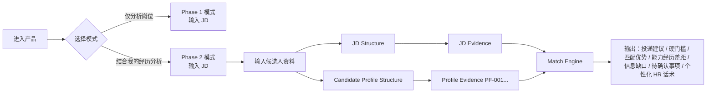

# Phase 2 产品规划与 Contract 设计（PHASE-2-PLAN）

> 状态：**Phase 2.0 Contract = PASS / CLOSED；Phase 2.1 = PASS / CLOSED（ISSUE-025 Closed）；Phase 2.2A Match Core = PASS / CLOSED；Phase 2.2B-1 Recommendation Core = AUTHORIZED / IN PROGRESS；Phase 2.2B Strength/Gap 与 Phase 2.3 = NOT AUTHORIZED。**
> 生成日期：2026-08-08
> 前置基线：Phase 1 已关闭（PASS / Ready for Release，release baseline commit `2faca406e1ef4bcc4157a860fc8c9407bbced488`）；TC-01～TC-10 Contract 冻结。
> 性质：产品规划与流程文档；**产品协议基线见 `docs/PHASE-2-CONTRACT.md`**（Phase 2 唯一主要协议；Phase 2.0 已通过并关闭）；本文件本身不构成跨 Gate 实现授权。

## 1. Product Goal

- **Phase 1**：`JD → 看懂岗位`（可信的 JD 分析，已发布）。
- **Phase 2**：`Candidate Profile + JD → 判断这个岗位是否适合这个用户`（Personalized Match MVP）。

Phase 2 在 Phase 1 的可信 JD 分析基础上引入真实候选人资料，建立 **JD Evidence + Profile Evidence 双向证据链**，输出可解释、可追溯的个性化岗位匹配结论。

Phase 2 要回答的核心问题：

1. 用户是否满足岗位硬门槛；
2. 用户哪些真实经历匹配核心职责；
3. 哪些要求只部分满足；
4. 用户主要差距在哪里；
5. 当前岗位应优先投、可以尝试、谨慎投还是暂不建议；
6. 如果投递，应基于哪些真实经历与 HR 沟通。

用户价值：从"看懂岗位"升级到"看懂自己与岗位的关系"——每个匹配结论都可回溯到 JD 原文与候选人提供的原始事实，不编造、不猜测。

成功定义：**候选人事实幻觉 = 0**；每个 Match 结论具备 `status + reason + jdEvidence + profileEvidence + confidence`；无 Profile 时 Phase 1 行为完全保持；TC-01～TC-10 回归 10/10。

当前非目标：多岗位比较、投递看板、自动投递、账号系统、收费。

## 2. Core User Flow

文本流程：

进入产品 → 选择「仅分析岗位 / 结合我的经历分析」→（Phase 2 模式）输入候选人资料 → 输入 JD → JD Structure → Candidate Profile Structure → JD Evidence / Profile Evidence → Match Engine → 输出：

- 投递建议（priority / try / cautious / not_recommended）；
- 硬门槛（met / partial / unmet / unknown）；
- 匹配优势（仅 Profile Evidence 支持）；
- 能力/经历差距（区分 unmet 与 unknown）；
- 信息缺口；
- 待确认事项；
- 个性化 HR 打招呼话术。

模式保留：

- 无 Candidate Profile → **Phase 1 模式**（保持现有行为，`candidateProfileProvided=false`）；
- 有 Candidate Profile → **Phase 2 模式**（`candidateProfileProvided=true`）。

## 3. Functional Scope

### F2-01 Candidate Profile Input

第一版**只允许人工填写或粘贴资料**（不支持文件解析/OCR/联网读取）。建议字段：

- 求职方向；
- 期望城市（可选）；
- 教育背景；
- 实习/工作经历；
- 项目经历；
- 技能；
- 证书（可选）；
- 作品/成果（可选）；
- 补充信息。

允许信息不完整。**禁止因缺失信息进行猜测**（缺失即 `unknown`，不得降级为 `unmet`，更不得编造）。

### F2-02 Candidate Profile Structuring

将 Profile 转为结构化事实，建立 **Profile Evidence（`PF-001`、`PF-002`…）**：

- 候选人原始事实（逐字/最小整理）与模型推断**必须分层**；
- 推断项必须锚定到具体 PF evidence，并标注 `inference` / `to_verify`；
- 无 PF 锚点的结论不得进入 Match 输出；
- Profile 事实校验规则与 Phase 1 evidence 规则同族（原文优先、逐字回落到 Profile 输入）。

### F2-03 Dual-Evidence Match Engine

核心匹配维度至少包含：

- hard requirement（硬门槛）；
- core capability（核心能力）；
- experience evidence（经历证据）；
- career direction（职业方向）；
- preferred / bonus requirement（加分项）。

状态优先采用：

- `met`（满足）
- `partial`（部分满足）
- `unmet`（不满足）
- `unknown`（信息不足，无法判定）

**Phase 2 第一版暂不引入 0–100 综合匹配分**（虚假精确）。

每个核心匹配结论必须包含：

- `status`
- `reason`
- `jdEvidence`
- `profileEvidence`
- `confidence`

禁止：因 JD 要求某技能而反向生成"候选人拥有该技能"。

### F2-04 Recommendation

推荐等级：

- `priority`（优先投）
- `try`（可以尝试）
- `cautious`（谨慎投）
- `not_recommended`（暂不建议）

推荐必须**同时**基于 JD Evidence 与 Profile Evidence，并体现：

- 支持证据；
- 反方证据；
- 信息缺口；
- 待确认事项。

推荐等级不得与硬门槛状态、风险信号、`unknown` 数量产生明显逻辑矛盾（Gate C）。

### F2-05 Personalized Strengths

允许输出真正的"你的优势"，但必须遵守：

- 用户没提供过的技能，不得生成；
- 用户没提供过的经历，不得生成；
- 用户没提供过的数字成果，不得生成；
- JD 要求某技能 ≠ 候选人拥有该技能；
- **候选人事实幻觉 = Phase 2 P0（0 tolerance）**。

### F2-06 Gap Analysis

差距分类（示例）：

- **A. 短期无法改变的硬门槛**（如学历、年龄、证书缺失）；
- **B. 有相关能力，但证据/表达不足**（能力可推断但 Profile 未充分呈现）；
- **C. 短期可能补足的能力**；
- **D. 当前 Profile 信息不足**。

特别约束："Profile 中没有 SQL 证据"**不能自动变成**"用户不会 SQL"——必须区分 `unmet` 与 `unknown`。

### F2-07 Personalized HR Greeting

- 只有 Profile Evidence 支持的候选人事实才能进入 HR 话术；
- Phase 1：`candidateProfileProvided = false`；
- Phase 2：`candidateProfileProvided = true`，并考虑 `personalizationStatus = personalized`；
- 当前阶段只设计 Contract，不实现。

### F2-08 Phase 1 Compatibility

- 无 Candidate Profile 时，Phase 1 必须保持完整可用；
- Phase 2 不得破坏 TC-01～TC-10 已冻结行为；
- 任何 Schema / Prompt / 服务端变更必须先过 Phase 1 Regression Gate（§8）。

## 4. Non-Scope（当前明确不做）

Phase 2 当前**不做**：

- 登录注册；用户账号体系；数据库；云端个人档案；
- PDF/DOCX 简历解析；OCR；JD 截图识别；自动读取招聘网站；
- 多岗位横向比较；投递进度管理；投递提醒；历史分析中心；
- 自动投递；自动联系 HR；AI 模拟面试；语音面试；一键完整改写简历；
- 订阅会员；支付；公司推荐；联网公司评价；
- 复杂 Agent；RAG；向量数据库；
- **0–100 综合匹配分**。

需要 PO 确认的边界（**不自行扩大 Scope**）：

- PDF/DOCX 解析与 OCR 不在 Phase 2 范围：第一版依赖人工粘贴文本（F2-01），**不构成 MVP 阻断**；
- "0–100 综合匹配分"明确不做：用 `met/partial/unmet/unknown` 替代，避免虚假精确。

## 5. Phase 1 P2 Carry-over Audit（基于真实记录，只读审计）

> 依据：`docs/PHASE-1-ACCEPTANCE.md` §3/§5/§6、`docs/验收执行报告.md`、`docs/更新日志.md`。

### ISSUE-012B

- **原始问题**：语义截断、关键字符缺失、片段乱序等真损坏 JD 的 evidence 无法逐字回落，Final evidence 链路失败（fail-closed 502）。
- **触发条件**：输入通过不了资格检查的损坏 JD（"词语被截断且后续字符缺失 / 关键字符缺失无法恢复 / 段落乱序"）。
- **已知证据**：真实样本 2 个——TC-03 1149 字符（乱序+错字+截断）、TC-05 1284 字符（"把控技术方"单点截断，初评与 repair 3/3 补全）。
- **当前影响**：不阻塞标准案例；输入门禁＋fail-closed 双保险（不返回未验证内容）。
- **是否仍可复现**：是（损坏输入仍会被门禁拦截/管线 fail-closed）。
- **与 Phase 2 关系**：Phase 2 引入 Candidate Profile 后，Profile 侧同样存在损坏输入风险，需同类防护（Profile Evidence 逐字规则）。
- **Phase 2 建议状态**：**Deferred（Robustness Track）**（已批准 Out of Phase 1 Scope）。
- **建议处理阶段**：Phase 2.4 Quality & Robustness（或独立 Robustness Track）。

### ISSUE-014

- **原始问题**：recommendation level 缺少确定性判定边界（信息不足场景仍可能输出 `worth_exploring`）。
- **触发条件**：JD 信息严重不足但模型决策偏积极（TC-04 3/3）。
- **已知证据**：TC-04 3/3 `worth_exploring`（unknowns 5/6/6、questions 6/7/5）；TC-09/TC-10 观察记录；未发现 level 与 unknowns/riskSignals/limitations 的明确逻辑矛盾。
- **当前影响**：低——建议等级语义边界缺失，但无自相矛盾输出。
- **是否仍可复现**：是。
- **与 Phase 2 关系**：Phase 2 的 `priority/try/cautious/not_recommended` 必须定义确定性判定规则；本 Issue 的协议设计是 Phase 2 Contract 的**前置输入**（F2-04/Gate C）。
- **Phase 2 建议状态**：**Committed（Contract 设计前置）**。
- **建议处理阶段**：Phase 2.0 Product / Contract Design。

### ISSUE-017

- **原始问题**：Requirement extraction completeness——content 片段化与独立要求整条遗漏。
- **触发条件**：stochastic（TC-06 第2次整条遗漏"计算机相关专业优先"）。
- **已知证据**：累计片段化 2 次＋整条遗漏 1 次，均 TC-06；TC-07～TC-10 共 0 次；遗漏项为 preferred（非 hard）。
- **当前影响**：低——未影响 hard 要求展示。
- **是否仍可复现**：是（偶发）。
- **与 Phase 2 关系**：匹配引擎依赖 requirement 完整性；遗漏 hard/preferred 会直接影响 Match 结论。
- **Phase 2 建议状态**：**Review**（先按真实频率复核后定 Committed/Deferred）。
- **建议处理阶段**：Phase 2.4（若 Phase 2.2 依赖暴露则提前）。

### ISSUE-019

- **原始问题**：HR safeGreeting fallback 高频触发，影响话术自然度稳定性。
- **触发条件**：HR 初稿越界（边界修复后走固定安全兜底）。
- **已知证据**：累计 15 次 / 33 有效请求 ≈ **45.5%**（TC-03～TC-07 13 次、TC-09 1 次、TC-10 1 次）；均为安全通用路径，无候选人幻觉、无信息丢失。
- **当前影响**：仅自然度（HR 维度 3.5 vs 4.0+）。
- **是否仍可复现**：是。
- **与 Phase 2 关系**：Phase 2 个性化 HR 话术对自然度要求更高；fallback rate 是明确质量优化指标（§9）。
- **Phase 2 建议状态**：**Committed（Quality Optimization Priority）**。
- **建议处理阶段**：Phase 2.3（话术）＋ Phase 2.4（质量指标）。

### ISSUE-021

- **原始问题**：工作特征强度无依据升级（frequency amplification）——JD 无频率依据处添加"频繁"。
- **触发条件**：workCharacteristics 推断生成（"适应出差/能接受出差/具有驾驶证"→"频繁出差/频繁使用驾驶证"）。
- **已知证据**：累计 13 次（TC-03 2/3、TC-08 6/6、TC-10 有效请求 5/5；TC-09 0/3、TC-04 0/3）；全部为"从职责看，可能"审慎推断；0/13 进入 riskSignals；0/13 影响 recommendation level；无修饰语跨从句转移证据。
- **当前影响**：画像/一致性维度扣 0.5～1.0；不改变确定性岗位事实。
- **是否仍可复现**：是（案例内高频率）。
- **与 Phase 2 关系**：Phase 2 的个性化优势/画像输出同样存在强度放大风险，且"Profile 无 SQL 证据 ≠ 不会 SQL"边界与之同族；需在 Contract 中定义 claim-强度约束。
- **Phase 2 建议状态**：**Committed（High Priority / Phase 2 Committed Review）**。
- **建议处理阶段**：Phase 2.0（Contract 约束）＋ Phase 2.4（质量指标与升级阈值复核）。

### ISSUE-023

- **原始问题**：requirement 偶发重复输出（模型同时输出拆分项与整句，服务端二次拆分致双份）。
- **触发条件**：TC-09 第1次（1/3）；TC-10 两轮 0/3。
- **已知证据**：仅 1 次；分类与 evidence 均正确，仅冗余。
- **当前影响**：低——未影响 recommendation / requirement 数量语义 / hard 展示。
- **是否仍可复现**：是（偶发）。
- **与 Phase 2 关系**：匹配数量与展示语义；若 Phase 2 复现率上升需处理。
- **Phase 2 建议状态**：**Review**。
- **建议处理阶段**：Phase 2.4（若复现率上升）。

## 6. 开发顺序规划

| 阶段 | 输入 | 产出 | 主要风险 | Exit Criteria | 是否允许进入下一阶段 |
|---|---|---|---|---|---|
| **Phase 2.0 Product / Contract Gate** | 本 plan、P2 Carry-over Audit、Phase 1 冻结协议 | 冻结的 Phase 2 Contract（Profile Schema、PF evidence 规则、match status 判定边界、推荐等级判定边界、HR 个性化边界、Gate 定义） | Scope 蔓延；证据链定义不清；与 Phase 1 Contract 冲突 | Contract 经 PO/QA Gate 评审通过；无未决 P0/P1 设计问题 | 是（授权后） |
| **Phase 2.1 Candidate Profile Foundation** | Contract | F2-01/F2-02 实现：Profile 输入、结构化、PF evidence 管线、Profile 事实校验 | Profile 事实分层错误；幻觉；未知字段猜测 | Gate A（Profile Fact Integrity，0 tolerance）＋ 单测；`candidateProfileProvided` 分支不影响 Phase 1 | 是 |
| **Phase 2.2 Match Engine** | Contract、Phase 2.1 输出 | F2-03/F2-04/F2-06：双向证据匹配、推荐等级、Gap 分析 | unmet/unknown 混淆；判定边界模糊；推荐与证据矛盾 | Gate B（Dual Evidence Integrity）＋ Gate C（Recommendation Consistency） | 是 |
| **Phase 2.3 Personalized Greeting** | Contract、Phase 2.2 输出 | F2-05/F2-07：个性化优势与 HR 话术 | 话术幻觉；越界事实入话术 | Gate A 复查 ＋ Gate D（HR 话术真实性维度） | 是 |
| **Phase 2.4 Quality & Robustness** | Phase 2.1～2.3 输出 | ISSUE-019 fallback ≤20%、ISSUE-021 强度约束、ISSUE-012B 健壮性、Phase 2 TC 12 项×3 次真实请求、P2 复评 | 回归；范围扩大；质量指标达成方式违规（放宽约束） | Gate D（内容质量）＋ Gate E（Robustness） | 是 |
| **Phase 2.5 Regression + Final Release Gate** | Phase 2.4 输出 | Phase 1 TC-01～TC-10 完整重跑 10/10 ＋ Phase 2 TC 全绿；Final Report | Phase 1 Contract 回归 | Phase 1 Regression Gate ＋ Phase 2 Gates 全部满足 → 提交 PO/QA Final Release Gate | 是（人工批准后发布） |

## 7. Phase 2 Acceptance Gates

### Gate A — Profile Fact Integrity

- 未经用户提供的候选人确定性事实：`0`；
- 候选人事实幻觉：`0 tolerance`（Phase 2 P0）。

### Gate B — Dual Evidence Integrity

- JD claim → JD evidence；
- Candidate claim → PF evidence；
- Match claim → JD evidence ＋ PF evidence；
- 不得因 JD 要求某技能就反向生成候选人拥有该技能。

### Gate C — Recommendation Consistency

- 推荐等级不得与硬门槛、风险、`unknown` 状态产生明显逻辑矛盾。

### Gate D — Content Quality

人工质量评分建议维度：

- Profile 事实准确性；
- 匹配逻辑；
- 优势真实性；
- Gap 准确性；
- Recommendation 合理性；
- HR 话术真实性；
- 信息克制；
- 表达质量。

Final Gate 目标（暂定，待 Phase 2.0 评审确认）：

- 综合平均 ≥ 4.0 / 5；
- 最低单项 ≥ 3.0；
- P0 = 0；
- 系统性 P1 = 0。

与 Phase 1 QA 体系的衔接：Phase 1 冻结口径为综合 ≥ 3.8 / 单项 ≥ 3.0；Phase 2 引入候选人事实后对准确性要求更高，建议综合门槛从 3.8 提升到 **4.0**，单项 ≥ 3.0 沿用（若 Contract 评审认为 4.0 不达可及，需给出数据后调整，不得无依据放宽）。

### Gate E — Robustness

至少规划以下 Phase 2 TC（每个关键 TC 最终进行 **3 次真实模型请求**）：

1. 高匹配；
2. 中等匹配；
3. 明确硬门槛不满足；
4. 跨专业但存在可迁移能力；
5. 候选人经历很少；
6. Profile 信息不完整；
7. JD 信息不完整；
8. JD 要求很多但 Profile 证据很少；
9. 项目经历高度相关；
10. Profile 包含大量无关信息；
11. JD/Profile Prompt Injection；
12. 长 JD + 长 Profile 压力测试。

## 8. Phase 1 Regression Gate

- Phase 2 Final Release 前必须完整重新运行 **TC-01～TC-10**（冻结输入不变），目标 **10/10 PASS**；
- 任何 Phase 2 修改导致 Phase 1 Contract 失败，**默认视为 Regression**，不得仅以"Phase 2 新设计"为理由接受；
- 回归失败 → 停止并修复后再评估。

## 9. ISSUE-019 fallback 专项目标

**真实记录核验（2026-08-08）：**

- 累计 fallback **15 次**（TC-03～TC-07 累计 13；TC-09 第2次 1；TC-10 修复后回归 run2 1）；
- 有效最终输出请求 **33 次**（TC-01 两轮 6；TC-02/03/04/05/06/07/08/09 各 3；TC-10 修复后 3）；
- fallback rate ≈ **45.5%**（15/33）。

**Phase 2 目标：固定回归集（Phase 1 TC ＋ Phase 2 TC）fallback rate ≤ 20%。**

禁止通过以下方式人为降低：

- 放宽 Final Schema；
- 删除 evidence；
- 降低事实约束；
- 静默吞核心字段；
- 返回未经验证内容。

目标合理性：45.5% 基线偏高，但 fallback 是"HR 初稿越界 → 边界修复 → 固定兜底"的安全路径；Phase 2.3 个性化话术重设计应以生成质量提升为主。按固定回归集约 66 次请求估算，≤20% 对应 ≤13 次，具备可达性。若 Phase 2.3 实现后仍 >20%，应**先回归 Phase 1 HR 行为并评审目标合理性**，而不是放宽约束。fallback rate 不是唯一指标：必须同时跟踪自然度与信息损失。

## 10. 风险与依赖

- **Contract 前置**：Profile Schema、PF evidence 规则、match status 判定边界、推荐等级判定边界（含 ISSUE-014 协议设计）必须先在 Phase 2.0 冻结；
- **Phase 1 兼容**：任何 Schema/Prompt 变更不得破坏 Phase 1 行为（`candidateProfileProvided=false` 分支冻结）；
- **Prompt Injection**（Gate E TC-11）：JD/Profile 注入防护需在 Contract 阶段定义（输入清洗、输出校验）；
- **幻觉 P0 红线**：Profile 事实幻觉 0 tolerance，需 F2-05/F2-07 与 Gate A 双重约束；
- **Scope 纪律**：Non-Scope 清单（§4）除明确标注需确认的边界外，不自行扩大。

## 11. 待 PO / QA 确认事项

1. Phase 2.0 Contract Gate 最终确认（修订版已提交：Candidate Fact/Derived 分离、partial 重冻结、推荐矩阵去数量阈值、confidence 不输出、14 TC、Gate F 冻结、四类 fallback 指标、Greeting 禁 profile_inferred）；
2. Contract 已决项见 `docs/PHASE-2-CONTRACT.md` §21；仅存未决项见 §22；
3. Gate F 综合 ≥4.0 / 最低 ≥3.0：**已冻结**；
4. fallback ≤20%：仅 `hrSafeFallbackRate provisional quality target`；
5. Phase 2 TC 冻结集 = **14 个**；待 PO 提供 14 个 TC 的真实脱敏 JD/Profile 输入素材。
